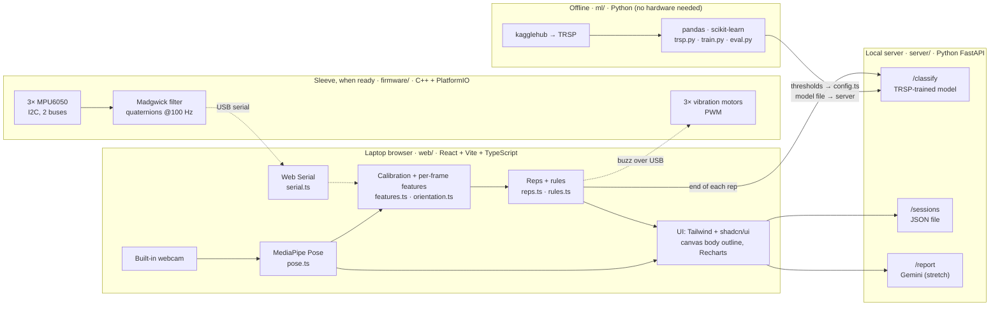
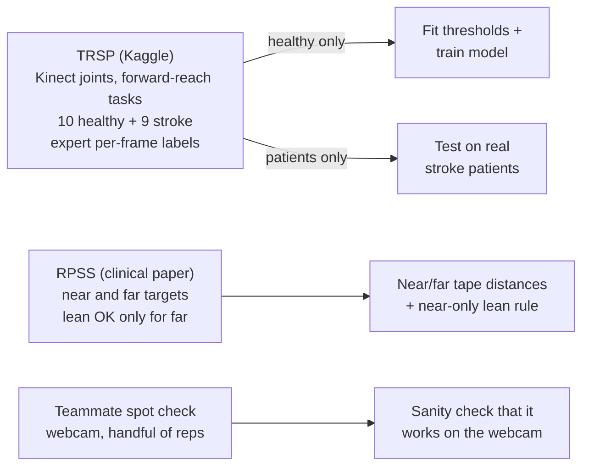
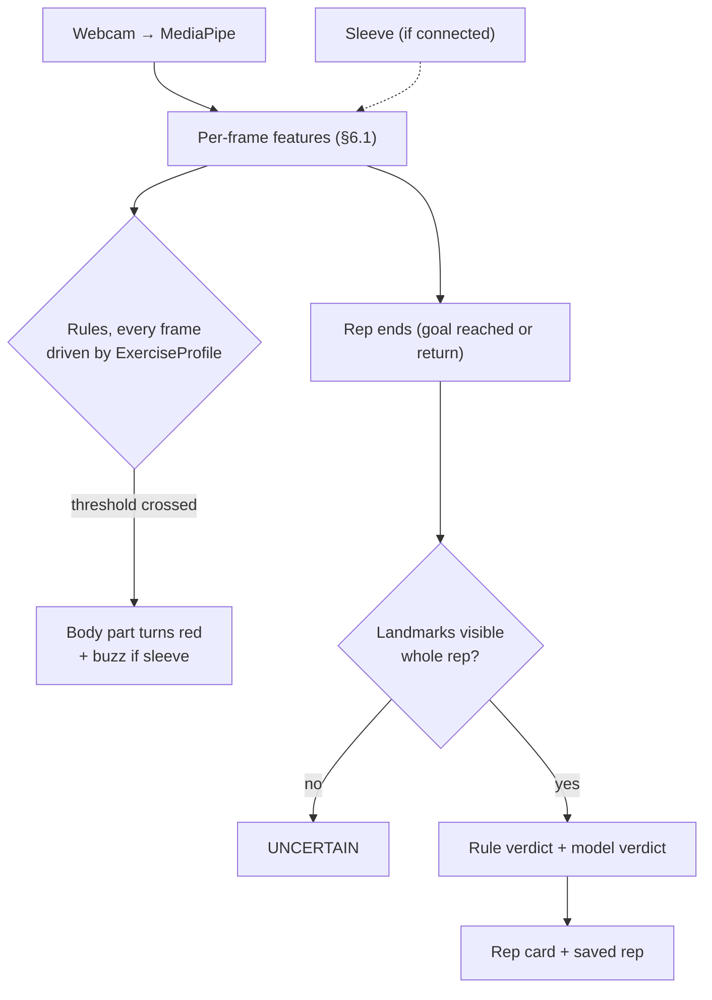
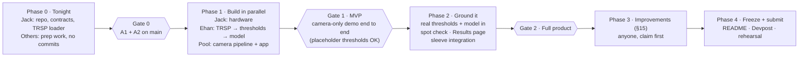
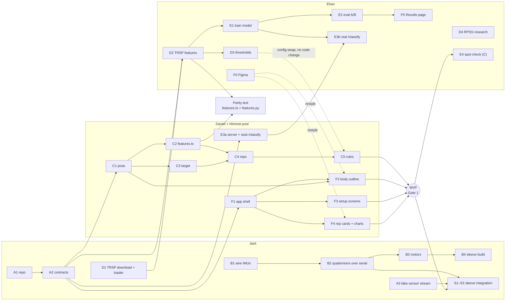

# TrueReach — Project Plan (v5)

**This file is the source of truth.** Code follows the plan.
- The only edits allowed to existing lines are ticking a checkbox and adding or removing an `@name` claim on a task (§14, §15).
- Every other change goes in the change log (§20) using the process in §19.

**Quick start:**
1. Find your name in §13.1.
2. Look at your lane in §14.
3. Check the wait points in §13.4.
4. Read `CLAUDE.md`.

---

## 1. What we're building

A browser app on a laptop that watches a stroke patient do one prescribed reaching exercise through the laptop's built-in webcam, set up to the patient's side. When the patient compensates instead of using the arm (leaning the trunk, hiking the shoulder, twisting the trunk), the screen shows which body part is wrong and by how much. When the sleeve (ESP32 + 3 IMUs + 3 vibration motors) is ready, it adds more precise trunk angles, trunk rotation, and a buzz.

**The software is built camera-first.** The hardware lands late, so every software task works with the webcam alone. The sleeve plugs in when it's ready.

**Tracks:** Overall, Artificial Intelligence, Hardware & Physical Computing, Easy On The Eyes.
**Stretch tracks:** MLH Gemini (session report), MLH Tiger Data (session storage).
**Not doing:** SAM 2, Vultr, Raspberry Pi, external cameras.

### 1.1 Tech stack

Everything runs on **one laptop** (plus the sleeve when ready). No internet is needed except for the Gemini report.


Dotted lines = only once the sleeve is connected.

| Layer | Tool | Runs on | Why this tool |
|---|---|---|---|
| Pose | MediaPipe Tasks Vision PoseLandmarker (lite) | Laptop browser | Real-time on CPU, works without hardware |
| App | React + Vite + TypeScript, Tailwind + shadcn/ui, canvas overlay, Recharts | Laptop browser | Fast to build, looks clean, time-critical work stays local |
| Design | Figma | — | Ehan's mockups for the overlay, rep cards, and Results page |
| Server | Python 3.11 + FastAPI | Laptop (localhost) | Hosts the model and saves sessions |
| Training | pandas, scikit-learn | Laptop (offline) | Small data; trains in seconds |
| Data download | kagglehub | Laptop | Reproducible TRSP download for judges |
| Sensors | 3× MPU6050 via Adafruit_MPU6050 (`Wire` + `Wire1`) | ESP32 | Already owned; 2 I2C buses for 3 sensors |
| Orientation | Madgwick (Adafruit AHRS `updateIMU`) | ESP32 | One stable quaternion per sensor |
| Haptics | 3 vibration modules, PWM | ESP32 | Different buzz per warning |
| Link | USB + Web Serial API (Chrome) | Laptop | Most reliable for a live demo |
| Report (stretch) | Gemini API via google-genai; browser speech for read-aloud | Laptop → cloud | Writes the PT note from our numbers |

---

## 2. The core exercise: seated forward reach

| | |
|---|---|
| **Position** | Seated upright at a table, feet flat, back off the chair back, affected arm resting on the table |
| **Movement** | Reach straight forward to an object on the table, touch it, return to rest |
| **Variants** | **Near target** (within arm's length) and **far target** (beyond arm's length) |
| **Camera** | Laptop to the patient's affected side, webcam level, side view (§9) |

**Why this is the core:**
1. **TRSP backs it.** TRSP recorded stroke patients doing seated Reach-Forward-Backward with expert compensation labels. That's the only motion where our thresholds and model come from clinical data.
2. **RPSS backs it.** The Reaching Performance Scale for Stroke uses a near and a far target and gives us the rule that leaning is expected for far targets.
3. **It suits the sensors.** Forward reaching mostly moves against gravity, which a side camera and the MPU6050 both handle well.

**Built to extend:** every exercise is an `ExerciseProfile` (§16). Forward reach is the only **data-validated** one. Improvements I1–I2 (§15) add therapist-defined exercises, clearly marked as not data-validated.

---

## 3. What we're sacrificing for time, and what it costs

The full version would train and validate on data recorded with our own sleeve and webcam. **The hardware won't be ready in time to record that data,** so we take a simpler path. Every row is an accuracy sacrifice. The README must include this table under "Limitations (time constraints)".

| Full approach | What we do instead | Accuracy cost |
|---|---|---|
| Train the model on our own sleeve + camera recordings | Train on **TRSP** features (Kinect skeletons), apply live to webcam (+ IMU) features | **Domain shift:** live inputs come from a different sensor and camera angle than training. Live accuracy will likely be **lower** than our TRSP test numbers, and we can't measure by how much. |
| Leave-one-person-out test on our setup | Test on TRSP stroke patients + a small webcam **spot check** on teammates | No real accuracy number for our exact setup. The spot check is counts on a handful of acted reps, not a statistic. |
| Measure angle error against an inclinometer and protractor | Skipped (improvement I5) | Angle error is **not quantified**. |
| Automatic setup checks (camera tilt, sleeve placement, drift watch) | Only two checks: key landmarks visible, and held still during rest-pose capture | A tilted laptop or loose sleeve isn't caught automatically; the user follows the setup steps carefully instead. |
| Elbow-extension threshold learned from data | "Incomplete reach" = **didn't touch the target**. Elbow angle is only displayed. | A rep that touches with a bent elbow and a lean is caught by the lean flag, not as an incomplete reach. |
| Sequence models (GRU), TRSP pretraining + fine-tuning | One simple gradient-boosting model per frame (improvement I4 upgrades it) | Less ability to learn timing patterns. |
| Trunk rotation from the camera | Rotation only from the chest IMU, so it's detected **only with the sleeve** | Camera-only mode can't detect trunk rotation. |

**What stays solid:**
- Thresholds and the model come from clinician-labeled stroke data (TRSP), not our guesses.
- They're tested on real stroke patients who weren't used to build them.
- The near/far lean rule comes from a published clinical scale (RPSS).

---

## 4. Where every rule and number comes from



| Number or rule | Source | Notes |
|---|---|---|
| `T_LEAN`, `T_HIKE`, `T_ROT` (forward reach) | **TRSP healthy frames** (§5) | Tested on TRSP patients |
| Per-frame model | **TRSP healthy frames** (§7) | Tested on TRSP patients |
| Lean flagged for near targets only | **RPSS** | A clinical rule, not learned. Cite it. |
| `NEAR_RATIO`, `FAR_RATIO` | **RPSS** (D4) | Pull exact placements from the paper; don't guess |
| `MIN_FLAG_MS` | **TRSP** (tune on healthy) | Prevents one noisy frame from flagging a rep |
| `TOUCH_RADIUS`, `VIS_MIN` | **Team-set during the spot check** | Labeled in `config.ts` as hand-tuned |
| Thresholds for any other exercise | **Therapist input**, starting from forward-reach values | `validated: false`; the UI shows a "not data-validated" badge |

**Rule for everyone, including Claude:** every number in `config.ts` has a comment naming its source. Until a real value exists, use a clearly named placeholder.

---

## 5. Using TRSP, step by step

TRSP is **Kinect skeleton data with expert labels**, not IMU data. We use it to **fit** thresholds and the model on healthy participants and **test** both on stroke patients. None of this needs our hardware.

1. **Download (D1).** `ml/download_trsp.py` uses kagglehub, which needs a free Kaggle account + API token. Data goes to `ml/data/trsp/`, which is **gitignored**: the dataset is research-use-only, so we commit the script, not the data.
2. **Load and sanity-check (D1):**
   - about 10 `H*` and 9 `P*` subject folders
   - `Joint_Positions.csv` rows divide evenly by 25
   - frame count equals the `Labels.csv` row count
   - label numbers mapped to none / lean-forward / shoulder elevation / trunk rotation using the paper (via `np.unique`, never guessed)

   Output: a clean loader returning per-subject frames (joints × xyz) + labels + task name.
3. **Keep only Reach-Forward-Backward tasks (D2).** Mirror x for left-arm tasks (names containing `L`).
4. **Compute per-frame features (D2),** with the **same definitions** as live (§6.1), each as change from the recording's first second at rest. Drop recordings that don't start at rest, and log them.
5. **Thresholds (D3):** for lean, hike, and rotation, compare clean vs labeled healthy frames and pick the cutoff maximizing sensitivity + specificity − 1. Save one plot per feature.
6. **Model (E1):** train per §7 on healthy frames.
7. **Test (E2):** thresholds and model on the 9 patients (§8). Write to `docs/results.md`; thresholds go to `config.ts` with source comments.

**Known limits (README):**
- TRSP patients pushed a robot handle that supported the arm; ours reach freely.
- TRSP is 3D Kinect while we use a 2D side webcam.
- The live shoulder hike uses the ear, while TRSP uses the head.
- Shoulder elevation was the hardest compensation to detect even in the original study.

---

## 6. How a rep is judged

### 6.1 Per-frame features (identical in `web/src/lib/features.ts` and `ml/features.py`)

All are **change from the start of the rep** unless noted.

| Feature | Camera-only mode | With sleeve | TRSP (Kinect) equivalent |
|---|---|---|---|
| `leanDeg` trunk lean, signed, forward = + | shoulder→hip line vs image vertical | chest IMU forward tilt | SpineBase→SpineShoulder vs vertical |
| `hikeRatio` shoulder hike | drop in ear→shoulder distance ÷ shoulder→hip distance | same (camera) | drop in Head→shoulder vertical distance ÷ trunk length |
| `rotDeg` trunk rotation | `null` | chest IMU heading change | shoulder-to-shoulder line, horizontal plane |
| `elbowDeg` elbow angle (absolute, 180 = straight) | shoulder–elbow–wrist angle | upper-arm vs forearm IMUs | shoulder–elbow–wrist angle |
| `shoulderFlexDeg` (absolute; for other exercises, I1) | angle between hip→shoulder and shoulder→wrist | same (camera) | same joints |
| `vis` | min MediaPipe visibility of ear, shoulder, elbow, wrist, hip | same | — |

### 6.2 Decision flow



```
END OF REP (profile = current ExerciseProfile)
  if min(vis) < visMin                                    → UNCERTAIN
  flags = []
  lean check per profile.checks.lean:
      'near_only' → only when target is near (RPSS); 'always' → every rep; 'off' → never
      if checked and |leanDeg| > thresholds.lean for ≥ minFlagMs → trunk_lean
  if profile.checks.hike and hikeRatio > thresholds.hike for ≥ minFlagMs → shoulder_hike
  if profile.checks.rot and sleeve and |rotDeg| > thresholds.rot for ≥ minFlagMs → trunk_rotation
  if goal not reached (touch_target: never touched; shoulder_flex: never hit targetDeg) → incomplete_reach
  rule verdict  = flags or [clean]
  model verdict = POST /classify  (only if profile.useModel; forward reach only)
```

**Rules drive the live red highlight and the buzz.** **The model is a second opinion** on each rep card. `rules.ts` and `reps.ts` must be written **generically over `ExerciseProfile`**, so new exercises (I1, I2) need no rule-code changes.

---

## 7. The custom model

**What it is:** a gradient-boosting classifier (scikit-learn `HistGradientBoostingClassifier`) that looks at **one frame's features** and predicts that frame's TRSP label: none, lean, hike, or rotation. Two versions are trained:
- **4 features** (lean, hike, rotation, elbow), for sleeve mode
- **3 features** (no rotation), for camera-only mode

**Why it's worth having next to the rules:** each rule looks at one feature alone. The model looks at all features together, so it can use combinations and the elbow angle as context. We measure on TRSP patients whether it actually beats the rules (§8). If it doesn't, we say so.

**How a rep gets a model verdict:**
1. The browser sends the rep's frames to `/classify`.
2. The server labels each frame.
3. A compensation counts for the rep if it's predicted continuously for at least `MIN_FLAG_MS`.
4. The server drops lean on far targets (RPSS).

`incomplete_reach` stays rule-only.

**How it's trained (E1):**
1. Take TRSP **healthy** forward-reach frames, resampled to 30 Hz.
2. Run grouped cross-validation by person across the 10 healthy participants, so no person's frames sit in both train and test.
3. Pick settings, retrain on all healthy participants, and save to `ml/models/`.
4. Test once on the 9 patients (E2).

This is the only AI the detection uses. Gemini only writes the end-of-session report from numbers we computed. The upgrade path for this model is improvement **I4** (§15).

---

## 8. How we measure accuracy

| Check | Data | What we report | Needs hardware? |
|---|---|---|---|
| **A. Patient test** (main result) | TRSP stroke patients, never used for fitting | Per-class precision and recall for rules **and** model; **false alarm rate** (% of clean frames flagged), the most important number | No |
| **B. Healthy cross-validation** | TRSP healthy, grouped by person | Same metrics, to show the patient gap | No |
| **C. Webcam spot check** | 4 teammates × about 3 reps each of: clean-near, lean-near, lean-far (should be clean), shoulder-hike-near | A count table ("lean-near flagged 11/12"). Labeled as a small acted sample. | No |

**We claim:**
- performance on 9 real stroke patients
- the healthy-vs-patient gap
- that the webcam pipeline flags acted compensations in a spot check
- that the system says "uncertain" when it can't see the body

**We don't claim:**
- measured accuracy on our own setup
- quantified angle error
- clinical validation
- therapist replacement
- data validation for any exercise except forward reach

---

## 9. Using the app: setup, calibration, session

The therapist sets a prescription once: **affected side, exercise, target (near or far, for forward reach), reps, sets.** The app checks form on what was prescribed; it never decides the treatment.

### 9.1 One-time setup (once per patient and room, about 5 minutes)

| # | Do | Why it matters |
|---|---|---|
| S1 | **Fix the chair.** No armrests, about a hand-width between trunk and table edge. Tape the floor at the chair legs. Patient sits upright, feet flat, **back off the chair back.** | Same body position every session; the trunk must be free to show a lean. |
| S2 | **Place the laptop** to the affected side, about 1–1.5 m away. Raise it on a box or books so the webcam is at roughly shoulder height. Open the lid until the **screen is vertical** with the base flat, so the webcam is level. Point it straight at the patient's side. Frame head to hips plus the table. No bright window behind. | Camera lean is measured against the image's vertical, so a tilted lid adds error. **(Not auto-checked; a §3 sacrifice.)** |
| S3 | **Measure arm length:** seated, arm straight forward, from the bony tip of the shoulder to the tip of the middle finger. Enter it. | The near and far distances scale with it. |
| S4 | **Measure shoulder-to-table-edge** horizontally while seated in the S1 position. Enter it. | Converts "distance from shoulder" (RPSS) into "distance from table edge" (where the tape goes). |
| S5 | **Lay tape** at the two cm values the app shows, along a line straight out from the affected shoulder: `RATIO × arm length − shoulder-to-edge`. | Puts the targets where RPSS defines them for this patient. |

### 9.2 Every session

| # | Do | Why it matters | App check |
|---|---|---|---|
| C1 | **(Sleeve only)** Connect the sleeve, leave it flat and still, press **Zero sensors** (`G`). Put it on at the marked spots, arrows toward the hand. | Removes gyro offset that causes drift. | Rejects if moved during the 2 s window |
| C2 | Sit in the S1 position. | Matches the setup the tape was measured for. | — |
| C3 | **Rest-pose capture:** arm hanging straight down, relaxed. Hold still 3 s. | Defines "0" for every relative feature. | Rejects if moving or landmarks hidden |
| C4 | Tap **Near** or **Far**, put the object on that tape mark, and click it once on the video. | The click sets the touch point; near/far comes from the chosen mark. | — |
| C5 | **Reps:** hand on the table edge; reach, touch, return. Recapture the rest pose (C3) if the sleeve is adjusted or after about 10 minutes. | | `uncertain` if landmarks are lost |

**Judge demo shortcut:** the table is taped for a teammate's arm. A judge does only C1–C4 (about 30 seconds).

---

## 10. Web app demo look

- **Live body outline:** the MediaPipe skeleton (trunk, shoulders, arm) drawn as a thick glowing outline over the webcam feed, or as a stylized figure on a dark panel.
- **Colors:**
  - green = fine
  - amber = approaching threshold
  - red = compensating
  - only the offending part changes
- **On a flag:** a label at the body part with the number ("Trunk lean 14°") and a buzz icon pulsing in sync with the sleeve.
- **Target:** a ring around the clicked object, labeled near or far, that fills when touched.
- **Also:**
  - a rep counter
  - rep cards that slide in (rule verdict, model verdict, numbers, grey "uncertain")
  - live lean and elbow charts
  - a mode badge ("Camera" / "Camera + Sleeve")
  - a "not data-validated" badge on non-TRSP exercises
- **Figma:** Ehan's mockups (F0) set the look. The pool builds functional versions first and restyles when the mockups land.

---

## 11. 60-second judge demo

1. The judge sits at the taped table, laptop to their side. (If the sleeve is ready: sleeve and chest clip on, ankle weight on the wrist.)
2. Rest-pose capture, tap **Near**, click the bottle.
3. A normal reach: the outline stays green and the rep card says clean.
4. Lean in: the trunk turns red with "Trunk lean N°" (and the sleeve buzzes if connected).
5. Move the bottle to the far mark, tap **Far**, and lean: no flag, because leaning toward a far target is allowed (RPSS).
6. Results page: TRSP patient numbers for rules vs model, the false alarm rate, and the "Limitations (time constraints)" table, shown openly.
7. *(If improvements landed)* Add "Arm raise" in the exercise builder in 20 seconds and run one rep (I1/I2); Gemini summary read aloud (I3).

---

## 12. Hardware specifics (Jack)

- **I2C:** 100 kHz, short twisted wires.
  - `Wire` bus: upper arm (0x68) and forearm (0x69, AD0 tied high)
  - `Wire1` bus: chest (0x68)
- **Sensor placement:**
  - forearm: on the back of the forearm, about ⅔ of the way to the wrist
  - upper arm: on the outer upper arm, midway
  - chest: on the sternum
  - never on a joint
  - mark the spots on the sleeve, with an arrow toward the hand on each sensor
- **Orientation:** Madgwick (Adafruit AHRS `updateIMU`) on the ESP32 produces one quaternion per sensor at 100 Hz.
- **Motors:** power the module's VCC from 5V/VIN; only the PWM signal comes from a GPIO.
- **Robustness:** hot glue on joints, strain relief.

---

## 13. Team, phases, and dependencies

### 13.1 Who does what

| Person | Lane | Owns |
|---|---|---|
| **Jack** | Repo + TRSP loading + hardware + sleeve integration | A1, A2, D1 (Phase 0); B1–B4, A3, S1–S3 |
| **Ehan** | Data + model + some UI/design | D2, D3, D4, E1, E2, E3b, E4, F0 (Figma), F5, G1 data/model/limitations sections |
| **Daniel + Himmet** | Shared pool: camera pipeline + web app + server shell | C1–C5, F1–F4, E3a, G2, the backup demo video. **Each claims tasks from the pool with `@name`.** |

### 13.2 Phases (relative order, no clock times)



| Phase | Starts when | Ends when (gate) |
|---|---|---|
| **0 · Tonight** | Now | **Gate 0:** A1 + A2 merged (repo, branch protection, contracts) |
| **1 · Parallel build** | Gate 0 | **Gate 1 (MVP):** all P0 tasks merged. Camera-only: lean on near → trunk red; lean on far → no flag; rep cards show rule verdicts. Placeholder thresholds and stub `/classify` are fine. **Record a backup demo video right here.** |
| **2 · Ground it** | Gate 1 (each person starts their Phase 2 tasks as their own dependencies land) | **Gate 2:** real TRSP thresholds in `config.ts`, real `/classify`, Results page with checks A/B/C, sleeve integrated **if** hardware is ready |
| **3 · Improvements** | Gate 2, **and** your own Phase 2 tasks are done | Freeze |
| **4 · Freeze + submit** | Leave the **last ~6 hours** before the deadline | Devpost submitted at least 30 minutes early |

**If the sleeve isn't ready by the freeze,** we demo camera-only, show the sleeve as hardware in progress, and say so plainly.

### 13.3 Dependency map

Arrows mean "must be merged on `main` before the next one can use the real thing."



### 13.4 Wait points: who waits on whom, and what to do meanwhile

| Who | Waits for | Why | Do this meanwhile (never sit idle) |
|---|---|---|---|
| **Everyone** | A1 + A2 (Jack, tonight) | No repo or contracts yet | Ehan: D4 reading, F0 Figma. Pool: try MediaPipe PoseLandmarker in a scratch page outside the repo; install Node and Chrome. **No commits until Gate 0.** |
| **Ehan** D2 | D1 (Jack, tonight) | Needs the loaded TRSP frames | D4, F0 |
| **Pool** C5 real thresholds | D3 (Ehan) | Thresholds come from TRSP | Build with placeholder constants from A2. Swapping in real values is a `config.ts` change only. |
| **Pool** F4 model verdict | E3b (Ehan) | Needs the trained model | E3a stub `/classify` returns `{flags: [], probs: {}}`; the card shows "model pending" |
| **Pool** F2/F4 final styling | F0 (Ehan) | Look comes from Figma | Build functional, plain-styled versions first |
| **Ehan** E4 spot check | MVP (pool, Gate 1) | Needs the live camera pipeline | E1, E2, F5 with placeholder JSON |
| **Ehan** parity test | C2 (pool) + D2 (own) | Both feature implementations must exist | — |
| **Ehan** F5 real numbers | E2 (own) | | Build the page against a placeholder `results.json` |
| **Jack** S1–S3 | B2 (own) **and** C2, C5 on `main` (pool) | Integration plugs IMU features into the existing pipeline | A3 fake stream, B3, B4. Test S1 (serial reader) against the fake stream early. |
| **Anyone** I3 voice (report part) | F6 Gemini | Reads Gemini's output | I3b spoken live cues don't need F6 |
| **Anyone** I1/I2 | C5 generic over `ExerciseProfile` + Gate 2 | New exercises plug into the rules | — |

**Fully parallel from Gate 0 with zero waiting:** Jack's B1→B4, Ehan's D2→D3→E1→E2, the pool's C1→C5 and F1→F4.

---

## 14. Task list by person

**How to use it:**
- Claim by adding `@yourname` at the end of the line.
- Tick the box in the PR that finishes the task.
- Name your branch `<name>/<taskID>-<short>`.

**Priority:**
- **P0** = needed for Gate 1 (MVP)
- **P1** = needed for Gate 2

**Series** = do these in order. **Parallel** = no order needed.

### Jack
**Phase 0, series (blocks everyone):**
- [x] **A1 (P0)** Create the repo:
  - branch protection on `main` (PR required, 1 approval, no force push, no deletion)
  - squash merge only
  - commit `PLAN.md`, `CLAUDE.md`, `.github/pull_request_template.md`
  - `.gitignore`: `.env`, `ml/data/trsp/`, raw video, model files over 50 MB
  - empty folders per §17 with a one-line README each
- [x] **A2 (P0)** `web/src/lib/types.ts` exactly per §16. `web/src/lib/config.ts` with:
  - the `forward_reach` `ExerciseProfile` using clearly named placeholder thresholds
  - `// SOURCE: placeholder until D3` comments

  Scaffold `web/` (Vite + React + TS), `server/` (FastAPI hello), and `ml/` (requirements.txt) so nobody fights over scaffolding later.
- [ ] **D1 (P1)** `ml/download_trsp.py` + `ml/trsp.py` loader + the §5 step 2 sanity checks → `docs/results.md`.

**Phase 1, series:**
- [ ] **B1** Wire 3 MPU6050s per §12; the ESP32 prints raw data from all three.
- [ ] **B2** Madgwick quaternions as `D,` lines at 100 Hz; `S,READY`, `S,IMU_FAIL,<n>`, `G`, `P`/`S,PONG`.
- [ ] **B3** Motor patterns 0–3 via `V,<motor>,<pattern>`.
- [ ] **B4** Sleeve and chest clip with marked sensor spots.

**Phase 1, parallel with B:**
- [ ] **A3 (P1)** `web/src/lib/fakeSensor.ts`: emits `SensorFrame`s in the §16 format, for building S1–S2 before the hardware works.

**Phase 2, series (needs B2 + C2 + C5 on `main`):**
- [ ] **S1 (P1)** `lib/serial.ts`: Web Serial reader for `D,`/`S,` and writer for `V`/`G`/`P`.
- [ ] **S2 (P1)** `lib/orientation.ts`: IMU lean, rotation, and elbow relative to rep start; Zero-sensors flow; "Camera + Sleeve" mode switch.
- [ ] **S3 (P1)** Buzz on rule flags.

### Ehan
**Phase 0, parallel (no repo needed):**
- [ ] **D4 (P1)** RPSS → `docs/research.md`: near and far placement, exact wording of the near/far trunk rule, `NEAR_RATIO`/`FAR_RATIO`, citation.
- [ ] **F0 (P1)** Figma mockups: Session screen (outline colors, target ring, rep cards, mode badge), Setup screens, Results page.

**Phase 1, series (needs D1):**
- [ ] **D2 (P1)** `ml/features.py`: §6.1 features on TRSP forward-reach frames (§5 steps 3–4).
- [ ] **D3 (P1)** Thresholds from healthy frames → `config.ts` with source comments + plots in `docs/`.
- [ ] **E1 (P1)** `ml/train.py`: both model versions (§7).
- [ ] **E2 (P1)** `ml/eval.py`: checks A and B for rules and model → `docs/results.md` + `docs/results.json`.

**Phase 1–2, parallel:**
- [ ] **E3b (P1)** Replace the stub in `server/app/classify.py` with the real model (needs E1 + E3a).
- [ ] **F5 (P1)** Results page: check A/B/C tables from `results.json` + the §3 limitations table (build against placeholder JSON first).

**Phase 2 (needs Gate 1):**
- [ ] **E4 (P1)** Spot check C with teammates; set `TOUCH_RADIUS` and `VIS_MIN` (marked hand-tuned).
- [ ] **E5 (P1)** Parity test: `features.ts` and `features.py` give the same numbers on one saved pose sequence (needs C2).

### Daniel + Himmet (shared pool: claim with `@name`)
There are two natural lanes. Each person takes one lane first so you aren't editing the same files.

**Lane "Camera" (series):**
- [ ] **C1 (P0)** `vision/pose.ts`: MediaPipe PoseLandmarker (lite), side view, left or right side → `PoseFrame`.
- [ ] **C2 (P0)** `lib/features.ts`: §6.1 features (camera-only mode) + rest-pose capture with stillness and visibility checks.
- [ ] **C3 (P0)** `vision/target.ts`: Near/Far choice + one click → touch point; touch detection.
- [ ] **C4 (P0)** `lib/reps.ts`: rep start/end, **generic over `ExerciseProfile.goal`**.
- [ ] **C5 (P0)** `lib/rules.ts`: §6.2 rules, **generic over `ExerciseProfile`**, including `minFlagMs` and the lean modes.

**Lane "App" (F1 first, then parallel):**
- [ ] **F1 (P0)** App shell: Tailwind + shadcn/ui; pages Setup, Session, Results; routing; a page that runs on fake `PoseFrame`s.
- [ ] **F2 (P0)** Live body outline with green/amber/red per body part (§10); feed it fake flags until C5 lands.
- [ ] **F3 (P0)** Setup screens per §9.1 (computed tape distances) and session steps per §9.2.
- [ ] **F4 (P0)** Rep cards (rule verdict, model verdict or "model pending", numbers, grey "uncertain"), live lean and elbow charts, mode badge.
- [ ] **E3a (P0)** `server/`:
  - FastAPI `/health`
  - `/sessions` (JSON file)
  - **stub** `/classify` returning `{flags: [], probs: {}}`
  - `web/src/lib/api.ts` client

**After Gate 1:**
- [ ] **G2 (P1)** Backup demo video (camera-only), Devpost draft.
- [ ] **F6 (P2)** Gemini PT note via `/report` (needed by I3a).

### Everyone, Phase 4
- [ ] **G1 (P1)** README. Sections by owner:
  - setup + architecture + tech stack (pool)
  - hardware (Jack)
  - data, model, results, **"Limitations (time constraints)"** = §3 table + §5 known limits, citations (Ehan)
- [ ] **G3 (P1)** Demo script (§11), fallbacks tested (§18), two rehearsals.

---

## 15. Improvements (Phase 3: anyone, claim first)

**Rules for improvements:**
- Start only after **Gate 2** and your own Phase 2 tasks are done.
- Each improvement is **additive**: new files, new profile entries, or a toggle.
- The camera-only forward-reach demo must keep working with the improvement turned off.
- Claim with `@name` like any task.

### I1 · A second exercise: seated forward arm raise (therapist-input thresholds)
- **What:** arm straight, raise it forward to shoulder height, lower. Goal: `shoulderFlexDeg` reaches `targetDeg` (shoulder height ≈ 90°; the therapist can lower it). Compensations checked:
  - lean: `always` (patients often lean back to lift the arm)
  - hike: yes
  - rotation: yes, with the sleeve
- **Thresholds:** start from the forward-reach TRSP values as an educated default; the therapist can adjust them. Profile has `source: 'therapist'`, `validated: false`, `useModel: false`.
- **Honesty:** the UI shows a **"Not data-validated"** badge. The README says TRSP only covers forward reach, so these thresholds are educated estimates.
- **Work:** one new `ExerciseProfile` in `config.ts`. Because C4/C5 are generic, no rule code changes. Verify on yourself.
- [ ] **I1**

### I2 · Exercise builder (the demoable way to add exercises)
- **What:** a "Therapist → New exercise" form that creates an `ExerciseProfile`:
  - name
  - goal type + target
  - which compensations to check (lean off / near-only / always, hike, rotation)
  - thresholds, prefilled from forward reach
  - reps

  Saved to `localStorage`, with export/import as JSON. The new exercise appears in the prescription dropdown with the "Not data-validated" badge.
- **Demo:** create "Arm raise" live in about 20 seconds, then run a rep.
- **Depends on:** C4/C5 generic (built in Phase 1). Pairs naturally with I1.
- [ ] **I2**

### I3 · Voice
- **I3a, read the Gemini report aloud:** a "Listen" button on the session summary using the browser's built-in `speechSynthesis` (no key, no cost). Needs F6.
- **I3b, spoken live cues:** on a flag, say a short cue ("Sit back", "Relax your shoulder") with a cooldown so it doesn't repeat. Doesn't need F6. Helpful for patients who can't watch the screen during reps.
- [ ] **I3a**   - [ ] **I3b**

### I4 · Better-trained model (the upgrade path from §7)
The shipped model is the **low-time path**: trained only on TRSP, with no data from our own setup. I4 is the **branch-off** that closes the biggest §3 gaps.
- **It reuses everything:** the same §6.1 features, the same `/classify` contract, and the same `eval.py`.
- **A better model is just a new file in `ml/models/`.** No app changes. Old and new compare side by side on the Results page.

| Step | What | Needs | Closes which §3 gap |
|---|---|---|---|
| **I4a · Recorder** | `lib/recorder.ts`: during a rep, save `FrameFeatures[]` + a `recordedLabel` chosen **before** the rep → CSV | Gate 1 | — (enables the rest) |
| **I4b · Camera-only recordings** | 4 teammates × 5 classes (clean-near, lean-near, lean-far = clean, hike, incomplete) × ~10 reps. Review the video, log discards. | I4a; **no hardware** | Starts closing "no accuracy on our setup" |
| **I4c · Retrain + real test** | Train on TRSP healthy **+** our recordings. Test leave-one-person-out on our recordings. Report next to the TRSP-only model. | I4b | Gives the **first real accuracy number on our exact setup**; shrinks the domain-shift cost |
| **I4d · Sleeve recordings** | Same protocol with the sleeve on; retrain the 4-feature model | I4a + sleeve integrated | Same, for sleeve mode; rotation gets our own data |
| **I4e · Sequence model** | Small GRU on whole-rep feature sequences; optionally pretrain on TRSP healthy, then fine-tune on ours | I4c | "Can't learn timing patterns" |

Do I4a → I4b → I4c in order. Even I4a + I4b alone (about an hour, camera only) give real held-out numbers for our setup, which the AI-track judges will value most.
- [ ] **I4a**   - [ ] **I4b**   - [ ] **I4c**   - [ ] **I4d**   - [ ] **I4e**

### I5 · Sleeve angle check (5 minutes)
Phone inclinometer taped next to the chest IMU at 0°, 15°, and 30°; record the readings in `docs/results.md`. Closes "angle error not quantified" for lean.
- [ ] **I5**

### I6 · Smaller polish (any time after Gate 2)
3D arm from IMU quaternions (F7) · Tiger Data storage (F8) · per-session progress chart across sessions.

---

## 16. Contracts (change only via §19)

### Serial (ESP32 ↔ browser)
Baud 921600; fall back to 115200 and 50 Hz if lines get corrupted. One message per line, comma-separated.

| Direction | Message | Meaning |
|---|---|---|
| ESP32 → browser | `D,ms,uw,ux,uy,uz,fw,fx,fy,fz,cw,cx,cy,cz` | 100 Hz: ESP32 ms, then quaternions (w,x,y,z, 4 decimals) for upper arm, forearm, chest |
| ESP32 → browser | `S,READY` / `S,IMU_FAIL,<n>` / `S,PONG` | Status |
| browser → ESP32 | `V,<motor>,<pattern>` | Motor 1 upper arm, 2 forearm, 3 shoulder. Pattern 0 off, 1 pulse 150 ms, 2 double pulse, 3 on until off |
| browser → ESP32 | `G` | Re-measure gyro bias (sleeve still for 2 s) |
| browser → ESP32 | `P` | Ping |

### `web/src/lib/types.ts`
```ts
export type Quat = [w: number, x: number, y: number, z: number];
export type Side = 'left' | 'right';
export type Mode = 'camera' | 'camera+sleeve';

export interface SensorFrame { t: number; upper: Quat; fore: Quat; chest: Quat } // t = performance.now()
export interface Point2 { x: number; y: number; vis?: number }                   // normalized 0–1
export interface PoseFrame { t: number; side: Side; ear: Point2; shoulder: Point2; elbow: Point2; wrist: Point2; hip: Point2 }

export interface ExerciseProfile {
  id: string; name: string;
  source: 'TRSP' | 'therapist'; validated: boolean; useModel: boolean;   // only forward_reach: TRSP / true / true
  goal: { kind: 'touch_target' } | { kind: 'shoulder_flex'; targetDeg: number };
  usesNearFar: boolean;
  checks: { lean: 'off' | 'near_only' | 'always'; hike: boolean; rot: boolean };
  thresholds: { lean: number; hike: number; rot: number };               // sources in config.ts comments
  minFlagMs: number; visMin: number; touchRadius?: number; nearRatio?: number; farRatio?: number;
}

export interface Prescription { side: Side; exerciseId: string; target?: 'near' | 'far'; reps: number; sets: number }
export interface Calibration {
  t: number; mode: Mode; armLengthCm: number; shoulderToEdgeCm: number;   // tape measure (§9.1)
  restPose: PoseFrame; restQuats?: { upper: Quat; fore: Quat; chest: Quat }; // restQuats only with sleeve
}
export interface Target { point: [number, number]; near: boolean }        // click on object; near = chosen tape mark

// Same definitions in ml/features.py (§6.1).
export interface FrameFeatures {
  t: number; leanDeg: number; hikeRatio: number; rotDeg: number | null;
  elbowDeg: number; shoulderFlexDeg: number; vis: number;
}

export type CompLabel = 'clean' | 'trunk_lean' | 'shoulder_hike' | 'trunk_rotation' | 'incomplete_reach' | 'uncertain';

export interface RepResult {
  repId: string; exerciseId: string; tStart: number; tEnd: number; near?: boolean; reached: boolean; mode: Mode;
  maxLeanDeg: number; maxHikeRatio: number; maxRotDeg: number | null; minElbowDeg: number; maxShoulderFlexDeg: number; minVis: number;
  ruleFlags: CompLabel[]; modelFlags?: CompLabel[]; modelProbs?: Record<string, number>; recordedLabel?: CompLabel; // recordedLabel: I4 only
}

export interface SessionSummary { sessionId: string; startedAt: string; mode: Mode; prescription: Prescription; reps: RepResult[] }
```

### REST (FastAPI :8000, web :5173)
| Route | Request → Response |
|---|---|
| `GET /health` | → `{ ok, model, db }` |
| `POST /classify` | `{ exerciseId, frames: FrameFeatures[], near: boolean, mode: Mode }` → `{ flags: CompLabel[], probs: Record<string, number> }` |
| `POST /sessions` / `GET /sessions` / `GET /sessions/{id}` | `SessionSummary` → `{ sessionId }` / list / one |
| `POST /report` (F6) | `{ sessionId }` → `{ patientSummary, ptNote, highlights[] }` |

---

## 17. Repo layout

```
truereach/
├── PLAN.md  CLAUDE.md  README.md  .env.example  .gitignore
├── .github/pull_request_template.md
├── firmware/            # Jack: platformio.ini, src/main.cpp
├── web/src/
│   ├── lib/             # types.ts, config.ts (A2) · features.ts, reps.ts, rules.ts, api.ts (pool) · serial.ts, orientation.ts, fakeSensor.ts (Jack)
│   ├── vision/          # pool: pose.ts, target.ts, CameraView.tsx
│   ├── overlay/         # pool: body outline + colors
│   ├── components/  pages/   # pool (F1–F4) · Ehan (F5 Results)
├── server/app/          # pool: main.py, sessions.py, classify.py stub · Ehan: classify.py real model
├── ml/                  # Jack: download_trsp.py, trsp.py · Ehan: features.py, train.py, eval.py, models/ · data/ (gitignored)
└── docs/                # research.md, results.md, results.json, demo.md
```

---

## 18. Fallbacks

| If this breaks | The demo still works because |
|---|---|
| Sleeve not ready / loose wire | Camera-only mode is the default and complete |
| Server / model | Rules still flag; rep cards show the rule verdict only |
| Webcam | Sleeve mode: IMU lean and rotation still flag and buzz; reps end on return |
| Touch detection misses | Re-click the object; reps also end on return to rest |
| Gemini | A template report fills in the same numbers |
| Everything live | Play the backup demo video recorded at Gate 1 |

---

## 19. GitHub + Claude workflow

### One-time setup (task A1)
1. Add a branch protection rule on `main` in the repo settings:
   - require a pull request
   - require 1 approval
   - block force pushes
   - block deletion
2. Allow **squash merging only.** Every PR becomes one commit on `main`, so any PR can be undone with one revert.

### Every task
1. **Check dependencies first.** In §13.3–13.4, is everything your task needs ticked **and merged on `main`**? If not, build against the contract with fakes or stubs (see `CLAUDE.md`), or pick another unblocked task.
2. Claim the task (`@name`), then `git checkout main && git pull`, then `git checkout -b <name>/<taskID>-<short>`.
3. Start Claude with: *"Read PLAN.md and CLAUDE.md. I'm <name>, working on task <ID>."* Claude Code reads `CLAUDE.md` automatically; in the claude.ai app, attach both files.
4. Commit small. Before opening a PR, merge the latest `main` into your branch (`git fetch && git merge origin/main`) and make sure it still builds.
5. Open the PR with the template. A teammate approves after checking two things: does it match the plan, and does it run.
6. After merging, run the demo on `main`. If it works, tag it: `git tag good-<short-name> && git push --tags`.
7. Post in team chat: "**<taskID> merged**". Anyone waiting on it (§13.4) pulls `main` and swaps their stub for the real thing.

### Undoing a wrong direction
- **One bad PR:** click **Revert** on the merged PR, then merge the revert PR it opens.
- **Several bad PRs:** revert each, newest first. Never rewrite `main`'s history.
- **Demo emergency:** `git checkout good-<tag>` runs the last known-good state.
- **Never:** `git push --force`, `git reset --hard` on a shared branch, or committing directly to `main`.

### Changing the plan
- Add a line to §20: `- [PROPOSED] <name> · what · why · tasks affected`
- Changes to contracts (§16), the core exercise (§2), the sacrifices (§3), data sources (§4–5), the model (§7), or accuracy checks (§8) need one teammate's OK in chat. That teammate marks it `[ACCEPTED by <name>]`.
- Plan changes go in their **own PR touching only PLAN.md**.
- Claude never implements a `[PROPOSED]` change until it's `[ACCEPTED]`.

### PR template (`.github/pull_request_template.md`)
```
**Task ID(s):**
**Depends on (task IDs) — all merged on main? (yes / no: which stub is used):**
**What changed:**
**How I tested it:**
**Plan deviations (link §20 entry or "none"):**
**Numbers added to config.ts and their source (or "none"):**
**Stubs added (STUB(<taskID>) markers) or removed:**
```

---

## 20. Plan change log (append only, newest at bottom)

- [ACCEPTED by team] Jack · v3:
  - one exercise (seated forward reach, near/far)
  - TRSP for thresholds and the patient test
  - RPSS for targets and the lean rule
  - `ExerciseProfile`
  - task list replaces per-person split
  - SAM 2 / Vultr cut
- [ACCEPTED by Jack] Jack · physical target on tape marks instead of the ghost ring.
- [ACCEPTED by Jack] Jack · full setup → calibration → session procedure.
- [ACCEPTED by Jack] Jack · laptop built-in webcam; tech stack diagram; custom AI explanation.
- [ACCEPTED by Jack] Jack · v4 time-crunch rewrite: camera-first; TRSP-only per-frame model; accuracy = TRSP patient test + spot check; sacrifices listed in §3.
- [ACCEPTED by Jack] Jack · v5:
  - owners (Jack: repo/TRSP loader/hardware/integration; Ehan: data, model, Figma, Results page; Daniel + Himmet: shared pool for camera pipeline, app, server shell)
  - relative phases and gates instead of clock times
  - dependency map and wait-points table
  - per-person series/parallel task lists
  - improvements I1–I6
  - `ExerciseProfile` made generic (goal, checks, source, validated, useModel)
  - `shoulderFlexDeg` added to features
  - `Prescription.exerciseId`
  - E3 split into stub (pool) and real model (Ehan)
