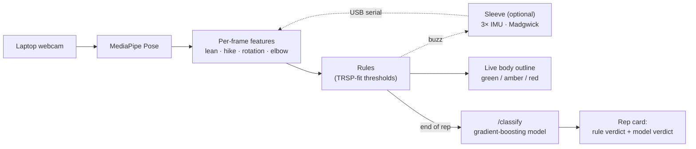

# TrueReach

**Real-time compensation feedback for stroke rehab reaching exercises, from a laptop webcam.**

A stroke patient does a prescribed seated forward reach next to a laptop. TrueReach watches through the built-in webcam. When the patient compensates instead of using the arm (leaning the trunk, hiking the shoulder, or twisting the trunk), the screen shows which body part is wrong and by how much. An optional sleeve (an ESP32 with 3 IMUs and 3 vibration motors) adds more precise trunk angles, trunk rotation, and a haptic buzz.

Built at **SwampHacks**.

## Why it matters

- **The problem:** most stroke rehab exercises are done at home, without a therapist watching. When the arm is weak, patients compensate by leaning the trunk or hiking the shoulder. The reach looks done, but the arm didn't do the work, and repeating that at home reinforces the wrong movement.
- **Who uses it, and when:**
  1. The therapist prescribes the exercise in clinic.
  2. The patient does it at home with a laptop (and the sleeve).
  3. The therapist gets a report of how many reps were clean, and which compensation showed up in the rest.
- **Why a sleeve, not just a webcam app:** a patient mid-reach can't watch a screen. A buzz on the arm or shoulder is feedback they feel without looking, like a therapist's hand on the shoulder. The camera sees; the sleeve tells the patient.
- **It understands the exercise, not just the angles:** leaning toward a near target is flagged, but leaning toward a far target isn't, because the clinical scale (RPSS) expects it there.
> **Status:** hackathon in progress. [`PLAN.md`](PLAN.md) is the source of truth for scope, tasks, and contracts.

---

## How it works



- **Camera-first:** everything works with the webcam alone. The sleeve plugs in when it's ready.
- **Grounded in clinical data:** the thresholds and the per-frame model are fit on healthy participants from the [**Toronto Rehab Stroke Pose (TRSP) dataset**](https://www.kaggle.com/datasets/derekdb/toronto-robot-stroke-posture-dataset) (Kinect skeletons with expert compensation labels) and tested on its **stroke patients**. The near/far lean rule comes from the **Reaching Performance Scale for Stroke (RPSS)**.
- **Rules drive the live feedback; the model is a second opinion** on each rep.

## Tech stack

| Layer | Tool |
|---|---|
| Pose | MediaPipe Tasks Vision PoseLandmarker (lite) |
| Web app | React + Vite + TypeScript, Tailwind + shadcn/ui, Recharts |
| Server | Python 3.11 + FastAPI (localhost) |
| ML | pandas, scikit-learn (`HistGradientBoostingClassifier`) |
| Data | TRSP via `kagglehub` |
| Hardware | ESP32, 3× MPU6050, 3× vibration motors, PlatformIO |
| Link | Web Serial API (Chrome) |
| Report (stretch) | Gemini API |

## Repo layout

```
├── PLAN.md  CLAUDE.md  README.md  .env.example  .gitignore
├── .github/pull_request_template.md
├── firmware/        # ESP32 sleeve: PlatformIO project
├── web/src/
│   ├── lib/         # shared types + config, features, reps, rules, API client, serial
│   ├── vision/      # pose + target detection
│   ├── overlay/     # body outline + colors
│   ├── components/  pages/
├── server/app/      # FastAPI: /health, /classify, /sessions, /report
├── ml/              # TRSP download + loader, features, training, eval (data/ is gitignored)
└── docs/            # research notes, results, demo script
```

## Getting started

**Prerequisites:** Node 18+, Python 3.11+, Chrome (for Web Serial), and a free Kaggle account + API token for the dataset.

```bash
# Web app → http://localhost:5173
cd web && npm install && npm run dev

# Server → http://localhost:8000
cd server && pip install -r requirements.txt && uvicorn app.main:app --reload --port 8000

# ML: download TRSP into ml/data/trsp/ (gitignored, research-use only; download script lands in D1)
cd ml && pip install -r requirements.txt && python download_trsp.py

# Firmware (PlatformIO project lands in B1)
cd firmware && pio run -t upload
```

---

## Team

| Person | Lane |
|---|---|
| **Jack** | Repo, TRSP loading, hardware, sleeve integration |
| **Ehan** | Data, thresholds, model, evaluation, Figma, Results page |
| **Daniel + Himmet** | Shared pool: camera pipeline, web app, server shell |

## Contributing (team workflow)

Full details are in [`PLAN.md` §19](PLAN.md) and [`CLAUDE.md`](CLAUDE.md). The short version:

1. **Find your task** in `PLAN.md` §14 and check its dependencies in §13.3–13.4. Everything it needs must be **merged on `main`**; a ticked checkbox isn't enough.
2. **Claim it** by adding `@yourname` to the task line.
3. **Branch:** `git checkout main && git pull && git checkout -b <name>/<taskID>-<short>`
4. **Stay in your lane's files** (§17). If you need something that isn't merged yet, build against `web/src/lib/types.ts` with a stub marked `STUB(<taskID>)`.
5. **Commit small:** `<taskID>: <what>`, e.g. `C2: rest-pose capture`.
6. **Before the PR:** `git fetch && git merge origin/main` (merge, never rebase), then build or run what you touched.
7. **Open a PR** using the template. One teammate approves; we squash-merge only.
8. **Announce** "`<taskID>` merged" in team chat so anyone waiting can swap out their stub.

**Never:** commit to `main` directly, force-push, or commit `.env`, API keys, Kaggle tokens, `ml/data/trsp/`, raw video, or model files over 50 MB.

**Using Claude Code:** start each session with *"Read PLAN.md and CLAUDE.md. I'm `<name>`, working on task `<ID>`."*

**Changing the plan:** append a `[PROPOSED]` line to `PLAN.md` §20 and get a teammate's OK. Plan changes go in their own PR.

---

## Hardware

*TODO (Jack, G1): wiring, sensor placement, serial protocol summary.*

## Data, model, and results

*TODO (Ehan, G1): TRSP processing, thresholds, model, patient-test results, citations.*

**Dataset:** [TRSP on Kaggle](https://www.kaggle.com/datasets/derekdb/toronto-robot-stroke-posture-dataset) (research use only; data files © original authors) · [reference code](https://github.com/zhiderek/TRSPD)

1. E. Dolatabadi, Y. X. Zhi, B. Ye, M. Coahran, G. Lupinacci, A. Mihailidis, R. Wang, B. Taati. *The Toronto Rehab Stroke Pose Dataset to Detect Compensation during Stroke Rehabilitation Therapy.* Pervasive Health, 2017.
2. Y. X. Zhi, M. Lukasik, M. Li, E. Dolatabadi, R. H. Wang, B. Taati. *Automatic Detection of Compensation during Robotic Stroke Rehabilitation Therapy.* IEEE JTEHM, 2017. doi:10.1109/JTEHM.2017.2780836

## Limitations (time constraints)

*TODO (Ehan, G1): the `PLAN.md` §3 sacrifices table plus the §5 known limits.*

**What we don't claim:** measured accuracy on our own setup, quantified angle error, clinical validation, or that this replaces a therapist.
