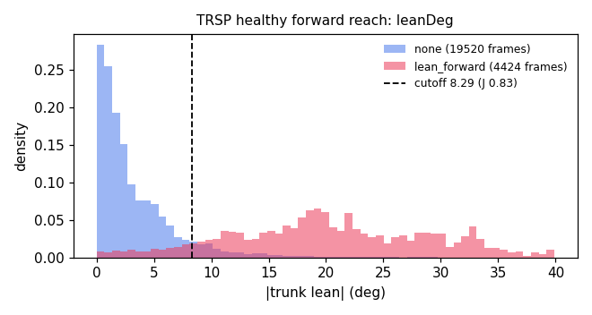
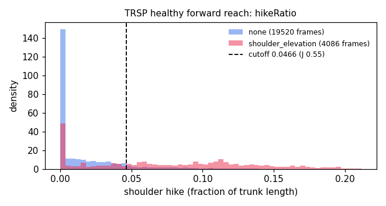
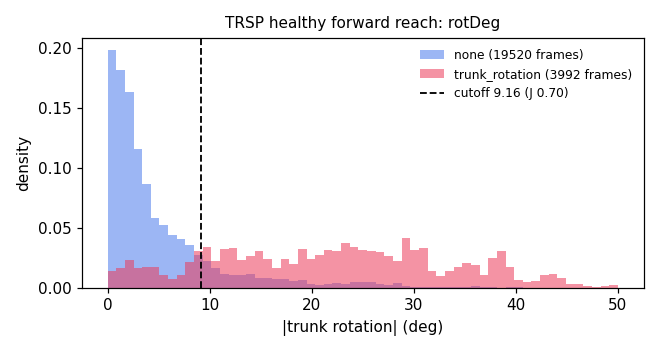

# Results

<!-- D1:start -->
## TRSP sanity checks (D1)

Generated by `python ml/trsp.py` from `ml/data/trsp/` (Kaggle `derekdb/toronto-robot-stroke-posture-dataset`, `data_new/` only; `robot/data_new/` is an identical copy and is skipped; `Labels - Copy.csv` files are skipped).

| Check (PLAN.md §5 step 2) | Result |
|---|---|
| Subject folders | 10 healthy (H01–H10), 9 patients (P01–P09) |
| Recordings / frames | 149 recordings, 70845 frames (39.4 min at 30 fps) |
| `Joint_Positions.csv` rows divide by 25 | all 149 pass |
| Frames = `Labels.csv` rows | all 149 pass |
| Label values (np.unique, all files) | [1, 2, 3, 4] |

### Label mapping

Confirmed from the healthy scripted tasks, where each task can only contain clean frames and the one acted compensation:

| Group | Task family | Frames per label value |
|---|---|---|
| healthy | `Rch_Fwr_Bck` | 1: 7528 |
| healthy | `Rch_Fwr_Bck_LnFwr` | 1: 4432, 4: 4424 |
| healthy | `Rch_Fwr_Bck_ShElev` | 1: 3546, 2: 4759 |
| healthy | `Rch_Fwr_Bck_TrRot` | 1: 4298, 3: 4176 |
| healthy | `Rch_Sd2Sd_Bck` | 1: 7521 |
| healthy | `Rch_Sd2Sd_Bck_TrRot` | 1: 5372, 3: 3854 |
| patient | `Rch_Fwr_Bck` | 1: 8185, 2: 519, 4: 290 |
| patient | `Rch_Sd2Sd_Bck` | 1: 10918, 3: 1023 |

→ **1 = none**, **2 = shoulder_elevation**, **3 = trunk_rotation**, **4 = lean_forward**.

### Axis order

Files store 3 columns per joint; the loader maps them to body axes x = subject's right, y = up, z = forward (col2 negated).

- col1 is vertical: Head above SpineBase in 100.0% of frames.
- col0 points to the subject's right: ShoulderRight.x > ShoulderLeft.x in 100.0% of frames.
- col2 points backward: the trunk tilts toward −col2 on label-4 frames in 20/20 `LnFwr` recordings (median change +22.0° forward, range +6.9° to +37.3°), and a wrist reaches in front of SpineShoulder in 34/34 `Rch_Fwr_Bck` recordings (smallest furthest reach +0.93).
- Units are not metres: median SpineBase→SpineShoulder length is 1.25 (a real trunk is about 0.5 m), so D2 should use only angles and ratios.

### Findings that affect later tasks

- **Forward-reach patients:** only 7 of 9 (P02, P03, P04, P05, P06, P07, P08). P01, P09 recorded only side-to-side tasks, so check A (§8) covers 7 patients, not 9.
- **Patient forward-reach labels** contain no trunk rotation (value 3), so rotation can't be tested on patients for this exercise.
- **No timestamps:** frame times assume the nominal 30 fps.
<!-- D1:end -->
<!-- D2:start -->
## TRSP features (D2)

Generated by `python ml/features.py`. Forward-reach tasks only; lean, hike, elbow and shoulder flexion on the sagittal plane, rotation in the horizontal plane; each relative to the recording's leading 'none' frames (up to 30, at least 5).

- Kept 89 recordings, 41016 frames (10 healthy, 7 patients).
- Dropped 3 without a clean start: H03/Rch_Fwr_Bck_ShElev_L, H03/Rch_Fwr_Bck_ShElev_R, H05/Rch_Fwr_Bck_TrRot_R.

Median per frame (lean, rotation, elbow, shoulder flexion in degrees; hike as a fraction of trunk length):

| Group | Label | Frames | `leanDeg` | `hikeRatio` | `rotDeg` | `elbowDeg` | `shoulderFlexDeg` |
|---|---|---|---|---|---|---|---|
| healthy | none | 19520 | +0.0 | +0.00 | +0.6 | +141.7 | +45.6 |
| healthy | shoulder_elevation | 4086 | +2.9 | +0.08 | +12.2 | +162.9 | +59.4 |
| healthy | trunk_rotation | 3992 | +3.8 | -0.03 | +21.4 | +160.4 | +62.7 |
| healthy | lean_forward | 4424 | +19.9 | +0.05 | +7.1 | +148.0 | +72.1 |
| patient | none | 8185 | -1.8 | +0.02 | +0.5 | +152.5 | +38.4 |
| patient | shoulder_elevation | 519 | -4.8 | +0.02 | +2.9 | +139.2 | +30.2 |
| patient | lean_forward | 290 | +4.2 | +0.01 | +2.3 | +150.9 | +66.9 |
<!-- D2:end -->

<!-- D3:start -->
## Thresholds (D3)

Generated by `python ml/thresholds.py` from `data/features.csv` (D2). **Healthy participants only** (H01–H10); patients are held out for E2. Each cutoff maximises sensitivity + specificity − 1 between clean frames and frames labeled with that compensation, on the magnitude `rules.ts` checks (|lean|, raised-only hike, |rotation|).

| Check | Feature | Label | Frames clean / labeled | Cutoff | Sens | Spec | J | Plot |
|---|---|---|---|---|---|---|---|---|
| lean | `leanDeg` | lean_forward | 19520 / 4424 | **8.29** | 0.92 | 0.92 | 0.83 |  |
| hike | `hikeRatio` | shoulder_elevation | 19520 / 4086 | **0.0466** | 0.67 | 0.89 | 0.55 |  |
| rot | `rotDeg` | trunk_rotation | 19520 / 3992 | **9.16** | 0.85 | 0.85 | 0.70 |  |

### Hold time (`minFlagMs`)

Replays the `rules.ts` timer on every healthy recording (30 fps) with the cutoffs above. Per-frame J for each check, and the number of false-alarm onsets on clean frames (each would be one buzz):

| Hold (ms) | J lean | J hike | J rot | Mean J | False-alarm onsets lean / hike / rot |
|---|---|---|---|---|---|
| 0 | 0.831 | 0.555 | 0.704 | 0.696 | 169 / 176 / 199 |
| 67 ← | 0.835 | 0.554 | 0.705 | 0.698 | 126 / 112 / 144 |
| 100 | 0.835 | 0.554 | 0.705 | 0.698 | 126 / 112 / 144 |
| 200 | 0.823 | 0.538 | 0.692 | 0.684 | 90 / 84 / 115 |
| 300 | 0.796 | 0.517 | 0.668 | 0.660 | 66 / 64 / 84 |
| 500 | 0.683 | 0.457 | 0.573 | 0.571 | 26 / 36 / 54 |
| 1000 | 0.422 | 0.318 | 0.327 | 0.355 | 9 / 15 / 25 |

→ `minFlagMs` = **67 ms** (highest mean J). Longer holds remove more clean-frame blips but miss more labeled frames; Kinect skeletons are smoother than the webcam, so E4's spot check may need a longer hold live. That would be a hand-tuned value, labeled as such in `config.ts`.

**Caveats:** the healthy scripted compensations are acted and large (median lean +19.9°, D2), while TRSP patients lean much less (median +4.2°). E2 reports how these cutoffs do on patients. The live hike uses the ear where TRSP uses Head (§5 known limits).
<!-- D3:end -->
